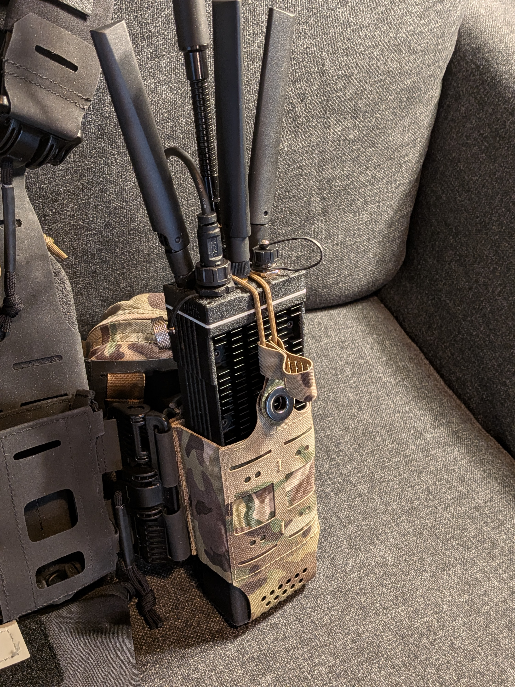

# rdt MANET Radio Enclosure

A 3D-printable, weather-resistant enclosure for a portable mesh radio node built around the Raspberry Pi Compute Module 4, Waveshare Mini Base Board (A), MediaTek MT7916 Wi-Fi 6E card and a Morse Micro MM8108 Wi-Fi HaLow board.

**Project:** [https://github.com/rdtrob/rdt_manet_enclosure](https://github.com/rdtrob/rdt_manet_enclosure)

---

## Overview




More pictures can be found in [images/](images/)

This repository contains the printable parts (STL) for a self-contained MANET radio node. The enclosure houses:

- **Raspberry Pi CM4** on a **Waveshare Mini Base Board (A)** carrier
- **MT7916 Wi-Fi 6E** M.2 card (via M→A/E-key adapter)
- **Morse Micro MM8108 Wi-Fi HaLow** board (USB-C connected)
- **Pololu D36V28F5** 5 V step-down regulator

Exposes three SMA antenna ports for the MT7916, one SMA port for the HaLow radio, a waterproof USB-C port, an M12 Ethernet connector and a magnetic pogo-pin power input.

---

## Features

- Fully 3D-printable body, no custom PCBs required
- 3× SMA bulkhead mounts for 2.4 / 5 / 6 GHz MIMO antennas
- 1× SMA bulkhead mount for the sub-GHz HaLow antenna
- Waterproof panel-mount USB-C for carrier board access
- M12 connector for ruggedized wired Ethernet
- 3-pin magnetic pogo-pin power input, regulated on board to 5 V
- Heat-set-insert design using M2.5 and M3 hardware

---

## Compatible Hardware

| Component | Model | Notes |
|---|---|---|
| Compute | Raspberry Pi Compute Module 4 — CM4004032 | 4 GB RAM, 32 GB eMMC, no onboard Wi-Fi/BT required |
| Carrier | Waveshare Mini Base Board (A) (CM4-IO-BASE-A) | Gigabit Ethernet, 2× USB 2.0, M.2 M-key (PCIe), 5 V USB-C input |
| Wi-Fi 6E | AsiaRF AW7916-AED (MediaTek MT7916AN) | M.2 A/E-key, 2.4 GHz 2T2R + 5/6 GHz |
| M.2 adapter | M.2 M-key → M.2 A/E-key adapter | Lets the A/E-key Wi-Fi card sit in the carrier's M-key slot |
| HaLow | Morse Micro MM8108 board | 802.11ah, connected to the carrier via USB-C |
| Regulator | Pololu D36V28F5 | 5 V, 3.2 A step-down regulator |

---

## Bill of Materials Summary

| # | Name | Description | Qty |
|---|---|---|---|
| 1 | Raspberry Pi Compute Module 4 | CM4004032: 4 GB RAM, 32 GB eMMC | 1 |
| 2 | CM4 carrier board | Waveshare Mini Base Board (A) | 1 |
| 3 | MT7916 Wi-Fi 6E board | AsiaRF AW7916-AED, MediaTek MT7916AN | 1 |
| 4 | M.2 A/E-key adapter | M.2 M-key to A/E-key adapter | 1 |
| 5 | MM8108 HaLow board | Morse Micro MM8108 Wi-Fi HaLow | 1 |
| 6 | Pololu buck converter | Pololu D36V28F5, 5 V 3.2 A step-down | 1 |
| 7 | SMA antenna | 2.4 / 5 / 6 GHz antenna for MT7916 | 3 |
| 8 | SMA antenna (HaLow) | 868 MHz SMA antenna for MM8108 | 1 |
| 9 | SMA cable, 2.4/5GHz | IPEX MHF 1 - SMA female cable assembly | 3 |
| 10 | SMA cable, sub 1GHz | Cable for SMA male to SMA female adapter | 1 |

---

## Printing

- **Material:** PA6-GF or PETG-CF for enclosure, TPU for gaskets
- **Layer height:** 0.08 mm
- **Walls/perimeters:** 2 - 4
- **Infill:** 35 % to 45 %
- **Supports:** Default, tree
- **Nozzle:** 0.4 mm
- **Orientation:** Bottom side up (battery connector facing upwards) or front-facing open side up

⚠️ Avoid PLA for field units: it softens in direct sunlight and in a warm vehicle.

---

## Assembly (high-level)

1. Seat the CM4 on the Waveshare carrier. Install the M.2 M→A/E adapter and fit the MT7916 card.
2. Connect the three IPEX leads to the MT7916 card before mounting; access is limited once installed.
3. Install the 3× SMA bulkheads, the HaLow SMA, the waterproof USB-C, the M12 connector and the magnetic pogo-pin connector in the enclosure walls.
4. Fix the carrier into the body with M2.5 screws.
5. Mount the Pololu regulator with M2.5 hardware and wire it: pogo-pin input → Pololu VIN/GND, Pololu 5 V output → USB-C cable → carrier board power input.
6. Mount the HaLow board and connect it to the carrier with the short USB-C to USB-C cable. Connect its antenna lead to the HaLow SMA bulkhead.
7. Connect Ethernet: carrier RJ45 → M12 internal cable.
8. Close the enclosure with M3 screws and nuts. Check that no cable is pinched at the lid seam.

---

## Power

```
[External source] ──► 3-pin magnetic pogo connector ──► Pololu D36V28F5 (5 V) ──► USB-C ──► Waveshare carrier
                                                                       ├── CM4
                                                                       ├── M.2 → MT7916 (3.3 V rail)
                                                                       └── USB-C → MM8108 HaLow
```

- The D36V28F5 accepts a wide input range and outputs a regulated 5 V.
- Double-check pogo-pin polarity before first power-up. There is no reverse-polarity protection on the carrier board.
- The Waveshare carrier's 5 V input is specified for about 2.5 A. The MT7916 card is the biggest single load.

---

## Thermal Notes

- The MT7916 card can draw several watts under load and needs its heatsink fitted.
- The CM4 benefits from a heatsink, especially in a sealed enclosure.
- A sealed printed enclosure has limited heat dissipation. For sustained high-throughput use or hot climates, consider reducing Wi-Fi TX power or adding ventilation.

---

## RF Notes

- Use antennas rated for the bands you operate on (2.4 / 5 / 6 GHz for the MT7916; your regional sub-GHz band for HaLow).
- Never transmit without antennas connected, can damage components.
- Keep IPEX-to-SMA pigtails short and avoid sharp bends.
- **You are responsible for operating within your local regulatory limits** (channels, transmit power, EIRP, 6 GHz availability).

---

## Software

This repository contains **hardware only**. For firmware and mesh configuration see:

- [very-srs/MANET](https://github.com/very-srs/MANET). This enclosure is primarily designed for use with the very-srs project but can fit OpenMANET as well.
- [OpenMANET](https://github.com/openmanet)

---

## License

This project is licensed under the **GNU General Public License v3.0**. See [LICENSE](LICENSE).

You may use, modify and redistribute these files, including commercially, provided that any distributed derivative is released under the same license and includes its corresponding source files.

Third-party components listed in the BOM are the property of their respective manufacturers and are not covered by this license.

---

## Disclaimer

This design is provided **as is, without warranty of any kind**. You assume all risk associated with building, powering and operating this device, including electrical safety, battery handling, weatherproofing and radio-regulatory compliance.

---

## Acknowledgements

- [very-srs/MANET](https://github.com/very-srs/MANET) and [OpenMANET](https://github.com/openmanet) projects.
- Raspberry Pi, Waveshare, AsiaRF, Morse Micro and Pololu for the hardware.